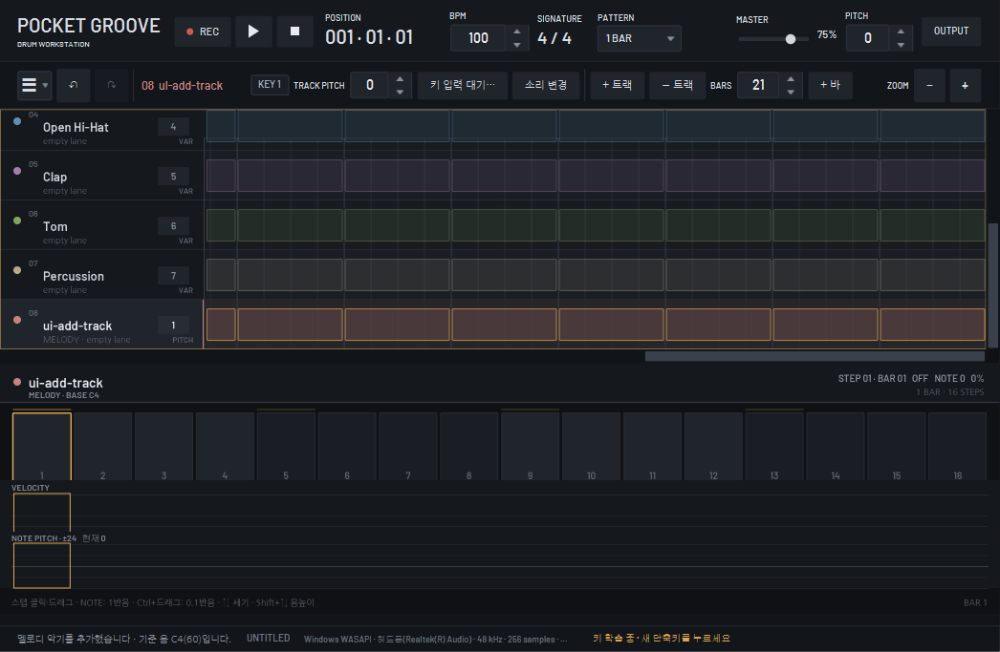
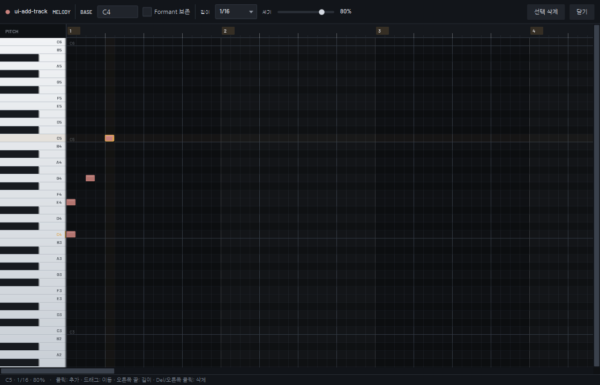

# Pocket Groove

6키 매크로 키보드로 시작하는 JavaFX 드럼·멜로디 워크스테이션. 기본 7트랙에서 최대 32트랙까지 늘릴 수 있고, DAW 스타일 타임라인과 16분음표 스텝 시퀀서에서 비트를 편집합니다. 멜로디 악기 트랙은 전용 피아노 롤에서 화음과 음표 길이까지 편집합니다. 기존 키보드 설정은 바꾸지 않으며 앱 창이 선택되어 있을 때만 입력을 받습니다.

소리는 타격마다 파일을 다시 여는 대신, 미리 PCM으로 준비한 뒤 계속 열린 오디오 출력에 즉시 더합니다. 멜로디의 고품질 피치는 Signalsmith Stretch로 미리 렌더링해 캐시하고, 실시간 재생과 WAV 내보내기가 같은 PCM을 사용합니다.

## 화면





## 실행

Windows x64 배포 ZIP을 **전체 압축 해제**하고 `PocketGroove/PocketGroove.exe`를 실행하세요. Java 설치가 필요 없습니다. `app`과 `runtime` 폴더가 필요하므로 exe만 따로 옮기지 마세요. 저장소에서 직접 빌드하면 실행 파일은 `dist/PocketGroove-0.6.3/PocketGroove/PocketGroove.exe`에 만들어집니다.

## 화면과 조작

### 트랙

기본 트랙은 **Kick, Snare, Closed Hi-Hat, Open Hi-Hat, Clap, Tom, Percussion**이고 기본 키는 `1`–`7`입니다.

- 왼쪽 트랙 헤더를 클릭하면 트랙이 선택되고 그 소리를 미리 들어볼 수 있습니다. 타임라인 lane 클릭은 트랙 선택과 편집 위치 이동입니다.
- **키 지정**을 누르고 매크로 키보드의 키를 누르면 선택 트랙에 연결됩니다. Ctrl/Alt/Shift 조합도 저장됩니다. Esc는 취소입니다.
- **소리 변경**에서 WAV(PCM 권장), MP3, AIFF를 고릅니다. 파일당 최대 16 MB입니다. 파일을 고르면 파형 창이 열리고, 양 끝을 드래그하거나 **앞뒤 무음 제거**로 원하는 구간만 가져올 수 있습니다. **미리 듣기**로 고른 구간만 재생해 확인할 수 있습니다. 선택 구간은 WAV로 저장됩니다.
- **+ 트랙**을 누르면 **드럼 트랙**과 **멜로디 악기** 중 하나를 고릅니다. 새 사운드 파일을 고르고 첫 번째 빈 문자 키를 자동 배정한 뒤 바로 키 지정으로 이어집니다. 최대 32트랙입니다. 소리를 고를 때 같은 파형 창에서 구간을 정합니다.
- **멜로디 악기** 트랙은 기본 음이 C4(MIDI 60)이고 Pitch Shift가 기본입니다. 트랙을 **더블클릭**하거나 헤더를 오른쪽 클릭해 **음표 편집…**을 고르면 피아노 롤이 열립니다. 왼쪽 건반은 실제 MIDI 음을 표시하고, 한 스텝에 여러 음을 배치해 화음으로 재생할 수 있습니다. 음표는 클릭으로 추가, 드래그로 이동, 오른쪽 끝 드래그로 길이 변경, Del 또는 오른쪽 클릭으로 삭제합니다. 툴바에서 기본 MIDI 음과 Formant 보존을 바꿀 수 있습니다.
- 멜로디 트랙도 스텝 시퀀서의 Velocity·NOTE PITCH 레인을 그대로 씁니다. NOTE PITCH는 기준 음에서의 반음 오프셋이며, 화음 전체를 평행 이동합니다.
- 트랙을 선택한 뒤 툴바의 **PITCH**로 그 트랙만 ±12반음 조절합니다. 재생 중에도 바뀌고 다른 트랙에는 영향을 주지 않습니다. 전역 PITCH와 트랙 PITCH, 스텝별 NOTE PITCH는 합산되어 MIDI 0–127 범위로 내보냅니다.
- 트랙 헤더를 **오른쪽 클릭**하면 피치 방식을 고릅니다.
  - **Pitch Shift (음높이만)**: 음높이만 바뀌고 샘플 길이는 유지됩니다.
  - **Varispeed (속도 변경)**: 음높이와 함께 재생 속도·길이도 바뀝니다.
  - 트랙마다 따로 저장되며, 헤더에 `PITCH` 또는 `VAR`로 표시됩니다.
- **− 트랙**은 선택 트랙과 그 트랙의 타격을 함께 지웁니다. 확인 후 삭제하며 남은 트랙의 타격 위치는 자동으로 당겨집니다.

선택한 트랙은 타임라인 lane과 헤더에 동시에 강조되고, 오른쪽 스텝 시퀀서가 그 트랙으로 바뀝니다.

### 타임라인

중앙은 곡 전체 마디를 트랙별 클립으로 보여주는 타임라인입니다. 반복 트랙은 같은 패턴이 마디마다 반복되고, 개별 트랙은 마디마다 독립된 클립으로 표시됩니다.

- 상단에 마디 번호, 세로줄에 마디·박 그리드가 있습니다.
- 클립 안의 작은 막대가 해당 트랙의 타격과 세기를 미리 보여줍니다.
- 재생 중에는 실제 오디오 위치를 따라가는 세로 재생선이 움직입니다.
- 마우스 휠로 위·아래 트랙과 시간축을 이동합니다. Ctrl+휠 또는 오른쪽 위 `ZOOM −/+`로 시간축을 확대·축소합니다.
- 타임라인 아래 가로 스크롤바로 전체 곡 마디 끝까지 직접 이동할 수 있습니다. 트랙 헤더(왼쪽 트랙 목록) 위에서도 `Shift+휠`로 가로 이동할 수 있고, 빈 곳을 **가운데 버튼으로 드래그**해도 화면이 이동합니다. 트랙이 많으면 오른쪽 세로 스크롤바로 내려갑니다.
- 툴바의 **BARS**는 곡 전체 마디 수입니다. 반복 트랙은 패턴이 새 마디에도 반복되고, 개별 트랙은 빈 마디가 늘어납니다.
- 타임라인 빈 곳을 클릭하면 편집 커서만 움직입니다. 재생 위치를 바꾸는 탐색 기능은 이 버전에 없습니다.

### 마디 선택·복사·붙여넣기·반복

- 마디를 마우스로 **드래그**하면 여러 트랙에 걸친 사각 범위를 선택할 수 있습니다.
- `Delete` 또는 우클릭 → **이 마디 지우기**로 선택한 마디의 패턴을 한 번에 지웁니다.
- `Ctrl+C` 또는 우클릭 → **복사**는 **한 트랙 안에서만** 됩니다. 여러 트랙 선택은 삭제만 됩니다.
- `Ctrl+V` 또는 우클릭 → **붙여넣기**는 복사한 원래 트랙에만 삽입됩니다. 선택한 마디가 없으면 그 트랙의 마지막 패턴 다음 마디에 붙습니다. 기존 패턴은 덮어쓰지 않고 뒤로 밀어 삽입하며, 공간이 부족하면 곡 마디가 자동으로 늘어납니다.
- 반복 트랙에 붙여넣으면 반복 패턴 안의 해당 위치에 삽입되고, 필요하면 패턴 길이가 자동으로 늘어납니다. 개별 트랙은 곡 마디에 삽입됩니다.
- 마디를 우클릭하면 **반복** 하위 메뉴에서 `예`/`아니오`를 고릅니다. 트랙 헤더 우클릭 메뉴에서도 같은 설정을 할 수 있습니다.
- **드럼 트랙은 기본 반복 `예`**, **새 멜로디 악기는 기본 반복 `아니오`**입니다.
- 반복을 `아니오`로 바꾸면 기존 패턴은 삭제되지 않고 각 마디의 독립 데이터로 펼쳐집니다. 반복을 다시 `예`로 바꿔도 저장된 마디 데이터는 삭제되지 않습니다.

### 스텝 시퀀서

선택 트랙의 현재 패턴 또는 선택한 마디를 16분음표 단위로 편집합니다.

- 기본 패턴은 1마디=16스텝이며, `PATTERN`을 2·4·8마디로 바꾸면 32·64·128스텝이 됩니다.
- 반복 트랙은 패턴 전체를, 개별 트랙은 타임라인에서 선택한 한 마디를 보여줍니다.
- 스텝을 클릭하면 추가/제거되고, 누른 채 드래그하면 연속으로 칠할 수 있습니다.
- 아래 **Velocity** 레인을 위아래로 드래그하면 타격 세기를 바꿉니다. 세기가 다른 타격은 타임라인 클립에도 다르게 보입니다.
- 맨 아래 **NOTE PITCH** 레인은 스텝마다 음높이를 ±24반음으로 정합니다. 점을 클릭하거나 위아래로 드래그하면 **1반음 단위로 딱딱 걸리며** 그 음만 계단식으로 올라가고 내려가서 한 트랙으로 멜로디를 만들 수 있습니다. **Ctrl을 누른 채 드래그하면 0.1반음 단위**로 세밀하게 조절됩니다.
- 선택한 스텝의 현재 음높이는 헤더의 `NOTE +1`과 피치 레인의 `현재 +1`, 선택된 점 옆의 `+1`에 표시됩니다. 0.1 단위면 `+3.4`처럼 소수점도 표시됩니다.
- 빈 칸을 클릭하면 그 음높이로 새 노트가 생깁니다.
- 트랙이 **Varispeed**이면 피치가 높을수록 소리가 짧고 낮을수록 길어집니다. **Pitch Shift**이면 길이는 그대로 두고 음높이만 바뀝니다.
- 스텝 시퀀서를 선택한 뒤 `←/→`로 스텝 이동, `Space`로 켜고 끄기, `↑/↓`로 세기, `Shift+↑/↓`로 그 스텝의 음높이를 조절할 수 있습니다.
- 재생 중에도 스텝을 편집할 수 있고, 변경은 곧바로 루프 오디오에 반영됩니다.

### 실행 취소·다시 실행

- `Ctrl+Z`는 마지막 편집을 되돌리고 `Ctrl+Shift+Z`(또는 `Ctrl+Y`)는 다시 실행합니다. 툴바의 `↶` `↷` 버튼도 같습니다.
- 스텝, Velocity, 스텝별 음높이, 트랙 추가·삭제, 소리·키 변경, 트랙 피치, 템포, 패턴 길이, 마디 삭제·붙여넣기, 반복 설정, 녹음 결과가 대상입니다.
- 파일을 저장한 뒤에도 저장 전 편집을 계속 되돌릴 수 있습니다. **새로 만들기**나 **열기**로 새 프로젝트를 열면 이력이 초기화됩니다.
- 텍스트 입력 칸에 커서가 있을 때는 그 칸의 자체 실행 취소가 우선합니다.

### 녹음·반복

1. 녹음할 트랙을 선택하고 `PATTERN`에서 1·2·4·8마디 중 길이를 정합니다.
2. **REC**를 누르고 그 트랙의 키를 연주합니다.
3. 루프 끝에서 자동으로 끝나며 반복됩니다. 중간에 **STOP**을 눌러 녹음을 일찍 끝내도 정해 둔 루프 길이는 유지됩니다.
4. `PLAY`로 반복 재생합니다. 템포는 40–240 BPM, 전체 피치와 트랙 피치는 각각 ±12반음입니다. 녹음 중에는 템포를 바꿀 수 없습니다.

녹음은 마이크가 아니라 패드 입력 기록입니다. **REC는 선택한 트랙만 새로 녹음**하고 다른 트랙의 타격은 그대로 유지합니다. 녹음 중에도 다른 트랙은 반주처럼 재생됩니다. **새로 만들기**는 빈 7트랙 프로젝트를 만듭니다.

### 파일 메뉴·저장·내보내기

왼쪽 위 **☰** 파일 메뉴에 **새로 만들기, 열기, 저장, 다른 이름으로 저장, 내보내기**가 있습니다.

- `Ctrl+S`: 이미 연 `.mdrum` 파일이 있으면 그 파일에 바로 덮어씁니다. 새 프로젝트라 파일이 없으면 자동으로 **다른 이름으로 저장** 창을 엽니다.
- `Ctrl+Shift+S`: 항상 **다른 이름으로 저장** 창을 엽니다.
- **내보내기**를 누르면 앱 안에서 **형식(WAV / MIDI)**과 파일 이름, 마디 범위를 정합니다. **찾아보기…**로 파일 탐색기에서 저장 폴더를 직접 고를 수 있습니다.
- 마디 범위는 기본값 **전체**입니다. `1-10`은 1~10마디, `3`은 3마디만, `전체`는 1~마지막 마디까지입니다.
- **WAV**: 32-bit float, 48 kHz로 앱 오디오와 같은 샘플을 저장합니다. DAW에서 마디·템포가 가장 정확히 맞습니다. 기본 형식입니다.
- **MIDI**: Standard MIDI File(format 1)로 저장합니다. 트랙별 이름, BPM 템포, 4/4 박자, 노트와 Velocity가 들어가고 각 트랙은 GM 드럼 채널 10으로 내보냅니다. 기본 노트는 Kick 36, Snare 38, Closed Hi-Hat 42, Open Hi-Hat 46, Clap 39, Tom 45, Percussion 49이며, 트랙/스텝 피치는 노트 번호에 반영됩니다.
- WAV는 DAW 프로젝트의 템포를 직접 바꾸지 않습니다. 내보내기 창에 적힌 BPM(예: 100)을 받는 DAW의 프로젝트에도 맞추면 마디와 박자가 정확히 맞습니다. MIDI에는 템포가 직접 기록됩니다.
- 저장 파일에는 소리·트랙 이름·단축키·악기 종류·기본 MIDI 음·Formant 설정·**트랙 반복 설정**·트랙별 피치·피치 방식·스텝별 음높이와 음표 길이·타격 위치·Velocity·템포·전체 피치·패턴 길이·전체 마디 수가 들어갑니다. v8 형식이며 이전 0.1–0.6.3 프로젝트(v1–v7)도 열 수 있습니다. 이전 프로젝트는 드럼 트랙과 기존 GM 음 매핑, 기존 반복 재생을 유지합니다.

### `.mdrum` 파일 연결

패키지된 앱을 처음 실행하면 현재 `PocketGroove.exe`를 `.mdrum` 파일의 기본 연결 프로그램으로 **현재 사용자 계정에 자동 등록**합니다. 관리자 권한은 필요하지 않습니다. 이후 `.mdrum` 파일을 더블 클릭하면 Pocket Groove가 그 프로젝트를 열어 줍니다. 앱을 새 버전 폴더로 옮기면 다음 실행 때 연결 경로도 새 EXE로 갱신됩니다.

Windows에서 이미 다른 앱을 `.mdrum` 기본 프로그램으로 직접 선택한 경우, Windows의 기본 앱 설정이 우선할 수 있습니다. 회사·학교 PC에서 관리자 정책으로 레지스트리 쓰기를 막아 둔 경우에는 자동 등록이 되지 않을 수 있습니다.

## 매크로 키보드 입력

다른 앱에서 문자 입력이 되는 매크로 키보드를 기준으로 다음 입력을 모두 같은 트랙에 연결합니다.

- 기본 일반 숫자 키 `1`–`7`
- 숫자패드 `Num 1`–`Num 7`
- 매크로 프로그램이 물리 키 코드 없이 **문자 이벤트**로 주입하는 `1`–`7`
- **키 지정**으로 직접 학습한 문자·숫자·F 키·조합키

화면 아래 입력 표시에 마지막 이벤트와 매칭된 트랙이 나옵니다. 예: `KEY_TYPED "1" → Kick`. 아무 키도 매칭되지 않으면 `미지정`, 창이 비활성이면 `포커스 없음`으로 표시됩니다. 이 표시로 실제 기기가 어떤 신호를 보내는지 확인할 수 있습니다.

기기 설정이나 HID 출력 명령은 바꾸지 않습니다. OS가 먼저 가로채는 단축키(예: Win 키, Alt+F4), 하나의 키가 다중 문자를 순서대로 내보내는 매크로는 한 트랙에 안정적으로 대응하지 않을 수 있습니다.

## 오디오 출력

`OUTPUT`에서 장치, 공유/단독 모드, 반응 속도를 바꿉니다.

- 기본값은 다른 앱과 소리를 같이 쓰는 **공유 출력**입니다.
- **빠른 연주 · 이 앱에서 단독 사용**은 오디오 장치에 따라 지원되지 않을 수 있고, 이 모드에서는 다른 앱이 같은 장치를 쓸 수 없습니다. 실패하면 이전 설정으로 자동 복구합니다.
- 작은 블록은 더 빠르게 반응할 수 있지만, 컴퓨터가 바쁠 때 소리가 끊길 가능성이 커집니다. 처음에는 `기본 · 256`을 권장합니다.
- “드라이버 추정” 숫자는 Windows가 보고한 출력 지연이지 물리 타건부터 소리까지의 실측값이 아닙니다. Bluetooth 출력은 자체 지연을 더합니다.

## 빌드

Windows, 재배포 가능한 JDK 17 이상(Temurin 권장), Visual Studio Build Tools의 C++/CMake, PowerShell이 필요합니다. Maven이 없으면 검증된 배포 파일을 프로젝트의 `.tools`에 내려받습니다.

```powershell
$env:JAVA_HOME = 'C:\path\to\temurin-jdk-17'
.\scripts\build.ps1                    # C++ 오디오 엔진 + Java 테스트
.\scripts\build.ps1 -Package           # 독립 실행 EXE + Java 런타임 + ZIP
.\scripts\build.ps1 -Package -UiTest   # JavaFX 화면·입력·녹음·스텝 통합 테스트
.\scripts\build.ps1 -AudioSmoke        # 실제 WASAPI 장치를 여닫는 통합 테스트
```

`-UiTest`와 `-AudioSmoke`는 오디오 출력 장치가 있는 대화형 Windows PC에서 실행하세요. 실제 키 타건과 DAC 출력 사이의 시간을 자동 실측하지는 않습니다.

개발용 실행은 네이티브 DLL을 먼저 만든 후 실행합니다: `.\scripts\build-native.ps1`, 다음 `mvn javafx:run`. 기본 샘플 재생성: `python scripts/generate_samples.py`.

GitHub Actions는 Windows 빌드 ZIP을 artifact로 제공합니다. GitHub Release 게시와 코드 서명은 자동으로 하지 않으며 EXE는 아직 서명하지 않았습니다. 배포 시 ZIP 전체와 해당 소스 버전·라이선스를 함께 제공하세요.

### 피치 캐시와 동기화

- Pitch Shift 트랙은 원본을 48 kHz로 리샘플한 뒤 Signalsmith Stretch로 `0.1반음` 단위 variant를 미리 렌더링합니다. 원본 길이를 유지하며 시작·끝 지연은 렌더러가 보정합니다.
- 필요한 음높이만 백그라운드에서 만들고, 같은 `(트랙, 반음, formant)` 조합은 한 번만 렌더링합니다. LRU 상한은 기본 256 MB이며 현재 프로젝트가 쓰는 variant는 제거하지 않습니다. 상한을 넘는 음은 재생하지 않고 상태 표시줄에 알립니다.
- 실시간 믹서와 WAV `OfflineMix`는 **같은 `PitchCache` PCM**을 사용합니다. 실시간 콜백에서는 파일 I/O·디코딩·Signalsmith 렌더링·캐시 생성을 하지 않습니다.
- WAV 이벤트 위치는 절대 beat에서 프레임을 계산해 누적 반올림 드리프트가 없습니다. 실시간 엔진도 같은 16분음표 beat와 48 kHz 프레임 기준으로 트리거합니다.

## 구조

- `DrumApp`: 화면, 입력, 파일 흐름, 녹음·편집 이력과 트랙 상태
- `ArrangementView`: 트랙 헤더·타임라인·클립·재생선 Canvas
- `StepSequencerView`: 16분음표 스텝과 Velocity Canvas
- `PianoRollDialog`: 멜로디 트랙의 피아노 롤 — 화음 추가·이동·길이·삭제, 음이름 기반 기본 음(C4=60), Formant 설정
- `Pattern`: 스텝·화음·음표 길이·Velocity·트랙 삭제의 순수 로직
- `SongTimeline`: 반복 트랙을 곡 마디로 펼치고 개별 마디 트랙은 절대 위치로 유지하는 재생/내보내기 공통 타임라인
- `NoteNames`: MIDI 번호와 `C4`, `F#3`, `Bb5` 표기 변환
- `KeyBindings`: 숫자패드·문자 주입·조합키 매칭
- `WaveformTrimDialog`: 가져올 소리의 파형, 양 끝 선택, 무음 제거, 선택 구간 미리 듣기
- `OfflineMix`: WAV가 쓰는 48 kHz 스트리밍 오프라인 믹서. Pitch Shift는 `PitchCache` PCM을 그대로 재생
- `WavExporter`: 지정 마디 범위를 32-bit float WAV로 정확히 저장
- `MidiExporter`: 지정 마디 범위를 Standard MIDI File(format 1)로 내보내기
- `ExportDialog`: 내보내기 형식(WAV/MIDI), 파일 이름과 마디 범위(`전체`, `1-10`, `3`) 입력
- `FileAssociations`: 패키지 EXE를 `.mdrum` 기본 프로그램으로 등록하고 시작 인자를 프로젝트 경로로 해석
- `native/mixer.cpp`: 여러 트랙을 합치고 반복 타이밍, 선택 트랙 녹음, 트랙별·스텝별 피치를 처리하는 엔진. 준비된 48 kHz 피치 variant를 음표별로 선택
- `AudioEngine`: JavaFX와 네이티브 엔진 사이의 제어 창구
- `Sounds`: WAV·AIFF·MP3 디코딩, 48 kHz 리샘플, 파형 자르기, WAV/PCM 쓰기
- `PitchRender`: 백그라운드 캐시가 쓰는 Signalsmith 고정 길이 피치 렌더러(JNI)
- `PitchCache`: `(트랙, 0.1반음, formant)` 키의 48 kHz LRU 캐시. 기본 상한 256 MB, 재생 중 variant 보호
- `ProjectIO`: 가변 트랙 `.mdrum` ZIP v8(악기 종류·기본 MIDI 음·Formant·트랙 반복·음표 길이 포함), v1–v7 호환, 임시 파일 기반 저장
- `src/main/resources/drum.css`: 화면 스타일

앱과 기본 소리는 MIT. MP3 **가져오기** 디코더는 LGPL 2.1이며, 라이선스와 교체 가능한 원본 JAR·소스 JAR을 배포 폴더에 포함합니다. 자세한 내용은 [THIRD_PARTY_NOTICES.md](THIRD_PARTY_NOTICES.md)를 보세요.
